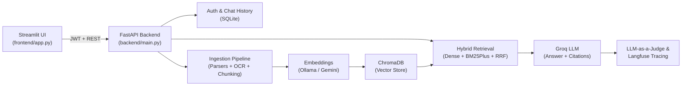

<div align="center">

# 📄 Finquiry

**Multi-User Document Intelligence & Conversational Q&A Platform**

[](https://www.python.org/)
[](https://fastapi.tiangolo.com/)
[](https://streamlit.io/)
[](https://www.trychroma.com/)
[](https://groq.com/)
[](LICENSE)

*Upload multi-format financial and business documents, query across a single file or your entire library with hybrid search, and get grounded answers with source citations.*

</div>

---

## ✨ Features

- **Hybrid Retrieval (Dense + Lexical + RRF)** — Combines ChromaDB semantic vector search with `BM25Plus` keyword matching fused via Reciprocal Rank Fusion (`RRF`) and metadata-aware routing.
- **Multi-Format Ingestion & OCR** — Supports `PDF`, `DOCX`, `XLSX`, `PPTX`, `CSV`, `TXT`, `MD`, `HTML`, and images (`PNG`, `JPG`, `TIFF`, `BMP` via Tesseract OCR) with company, department, document type, and fiscal year metadata.
- **Multi-User Auth & Isolation** — Registration and login backed by `scrypt` password hashing and JWT bearer tokens, isolating every user's documents and chat history.
- **Conversational Q&A with Citations** — Multi-turn persistent chat history powered by Groq with cited sources (company, filename, and page number).
- **Flexible Embeddings** — Runs locally with Ollama (`nomic-embed-text`, `bge-m3`, `all-minilm`) or via Google Gemini (`models/gemini-embedding-001`).
- **Observability & Evaluation** — Built-in privacy-conscious Langfuse tracing and LLM-as-a-Judge evaluation (Answer Relevance, Faithfulness, Completeness, Correctness).

---

## 🏗️ Architecture



---

## 📁 Project Structure

```text
Finquiry/
├── backend/
│   ├── main.py                      # FastAPI routes & schemas
│   ├── core/
│   │   └── config.py                # Paths, chunking & app config
│   ├── services/
│   │   ├── auth_service.py          # scrypt hashing, JWT auth, SQLite users
│   │   ├── ingestion_service.py     # Multi-format parsing, OCR, chunking
│   │   ├── embedding_service.py     # Ollama / Google Gemini embeddings
│   │   ├── retrieval_service.py     # Dense + BM25Plus hybrid search (RRF)
│   │   ├── chat_service.py          # Grounded Q&A & metadata routing
│   │   ├── history.py               # Conversation persistence (SQLite)
│   │   ├── evaluation_service.py    # Automated LLM-as-a-Judge scoring
│   │   ├── langfuse_service.py      # Tracing & score logging
│   │   └── latency.py               # Stage latency tracking
│   └── evaluation/
│       ├── evaluation_dataset.json  # Benchmark test cases
│       └── run_evaluation.py        # Benchmark runner (Langfuse)
├── frontend/
│   └── app.py                       # Streamlit UI (Login/Register, Upload, Chat)
├── .env.example                     # Environment variable template
├── requirements.txt                 # Python dependencies
└── LICENSE                          # MIT License
```

---

## 🚀 Quick Start

### Prerequisites

- **Python 3.11+**
- **Groq API Key** — [console.groq.com](https://console.groq.com/)
- **Ollama** *(default for local embeddings)* — [ollama.com](https://ollama.com/)
- **Tesseract OCR** *(optional, required only for image uploads)* — [tesseract-ocr](https://github.com/tesseract-ocr/tesseract)

### 1. Clone & Create Virtual Environment

```bash
git clone https://github.com/Tiwari-Tech/Finquiry.git
cd Finquiry
python -m venv .venv
```

Activate the environment and install dependencies:

```bash
# Windows (PowerShell)
.venv\Scripts\Activate.ps1

# macOS / Linux
source .venv/bin/activate

pip install -r requirements.txt
```

### 2. Pull Default Embedding Model (Ollama)

```bash
ollama pull nomic-embed-text
```

> To use Google Gemini embeddings instead, set `EMBEDDING_PROVIDER = "google"` in `backend/services/embedding_service.py` and add `GOOGLE_API_KEY` to `.env`.

### 3. Configure Environment Variables

```bash
cp .env.example .env
```

| Variable | Required | Description |
| :--- | :---: | :--- |
| `GROQ_API_KEY` | Yes | Groq API key for answer generation and evaluation |
| `JWT_SECRET_KEY` | Yes | Long random string used to sign JWT auth tokens |
| `GROQ_MODEL` | No | Groq model ID (default: `openai/gpt-oss-120b`) |
| `GOOGLE_API_KEY` / `GEMINI_API_KEY` | No | Required only when using Google embeddings |
| `LANGFUSE_SECRET_KEY` / `LANGFUSE_PUBLIC_KEY` | No | Enables Langfuse tracing and evaluation score logging |
| `LANGFUSE_BASE_URL` | No | Langfuse host URL (default: `https://cloud.langfuse.com`) |
| `ATA_EVALUATION_USER_EMAIL` | No | User account email for running `run_evaluation.py` |

### 4. Run the Application

Start the **FastAPI backend** (Terminal 1):

```bash
uvicorn backend.main:app --reload
```

Start the **Streamlit frontend** (Terminal 2):

```bash
streamlit run frontend/app.py
```

- **App UI**: `http://localhost:8501`
- **API Docs (Swagger)**: `http://127.0.0.1:8000/docs`

---

## 🔌 API Endpoints

| Method | Endpoint | Description |
| :--- | :--- | :--- |
| `GET` | `/health` | Health check |
| `POST` | `/auth/register` | Register a new user account |
| `POST` | `/auth/login` | Authenticate and receive a JWT access token |
| `GET` | `/system/embedding-config` | View active embedding provider, model, and dimension |
| `POST` | `/documents/ingest` | Upload, parse, chunk, and index a document |
| `GET` | `/documents` | List the current user's uploaded documents |
| `DELETE` | `/documents/{document_id}` | Delete a document and its vector chunks |
| `POST` | `/chat` | Ask a question across one document or all documents |
| `GET` | `/conversations` | List the current user's conversations |
| `GET` | `/conversations/{conversation_id}` | Fetch conversation metadata and message history |
| `DELETE` | `/conversations/{conversation_id}` | Delete a conversation |

---

## 📊 Running Evaluation

To run the benchmark suite and log metrics to Langfuse:

```bash
python -m backend.evaluation.run_evaluation
```

---

## 📝 Notes

- Runtime databases (`backend/data/users.db` and `data/chroma_db/`) are created automatically on first run and excluded from version control.

## 📄 License

Distributed under the [MIT License](LICENSE).
